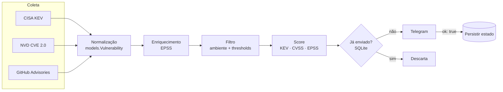

# Arquitetura

## Fluxo

## Camadas

| Camada | Pasta | Responsabilidade |
|---|---|---|
| Coleta | `app/collectors/` | Um módulo por fonte; retorna modelos normalizados |
| Enriquecimento | `app/enrichers/` | Agrega contexto (EPSS) a itens já coletados |
| Domínio | `app/models/` | `Vulnerability`, `Alert`, `Severity` |
| Regras | `app/core/` | Pipeline, filtros e priorização |
| Saída | `app/notifiers/` | Formatação segura e envio (Telegram) |
| Estado | `app/storage/` | Deduplicação e checkpoints em SQLite |
| Transversal | `app/utils/` | HTTP seguro e logging com redação |

## Filtro de ambiente

1. **Escopo** (`ScopeFilter`): `exclude` sempre vence (perfis, vendors, produtos e
   palavras-chave), inclusive para o KEV. Depois a vuln precisa casar com
   `environment.profiles` / `vendors` — pelo CPE da NVD, pelo nome do KEV ou, para CVEs
   ainda sem CPE, por vendor + produto citados na descrição. Com `alert_all_kev: true`,
   todo KEV novo que não foi excluído entra.
2. **Catálogo**: tudo que está no escopo é gravado na tabela `catalog` com categoria e
   severidade.
3. **Risco** (`passes_risk`): KEV sempre passa; os demais precisam de `min_cvss` ou
   `min_epss` (CVE sem métricas ainda passa como INFO se `include_unscored`).
4. **Dedupe**: só realerta um CVE se a severidade subir (ex.: ALTO → entrou no KEV).

## Princípios

1. **Fontes isoladas:** a falha de um coletor não derruba o pipeline.
2. **Envio confirmado:** só se marca como enviado após `ok: true` do Telegram.
3. **Seguro por padrão:** TLS verificado, timeouts, segredos só por ambiente.
4. **Extensível:** nova fonte = novo módulo em `collectors/`; novo canal = novo `notifier`.
